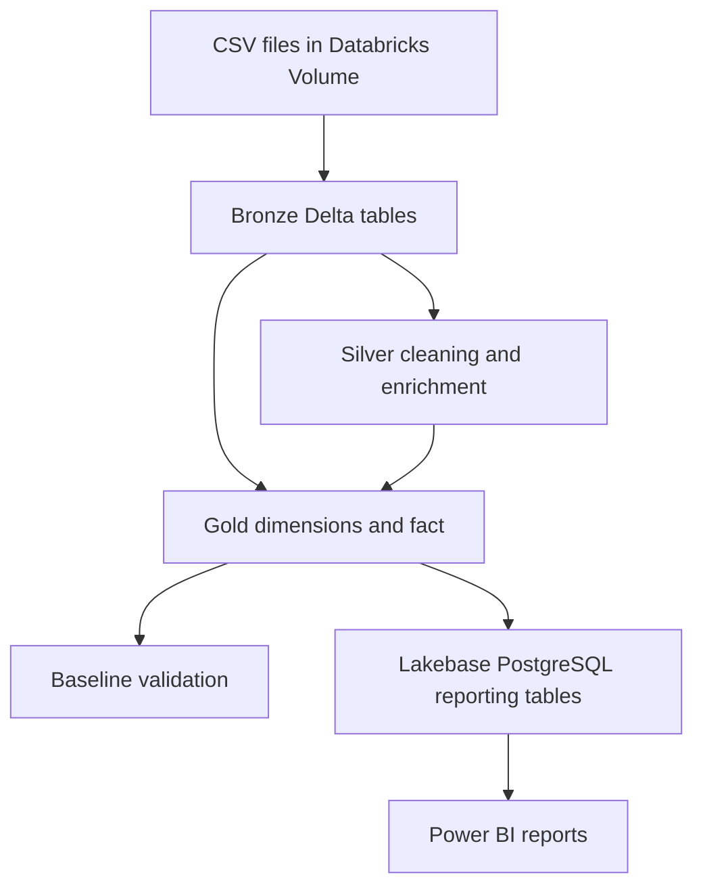

# Project Architecture

The pipeline transforms airline passenger records and airport reference
data into a dimensional warehouse for SQL analysis and Power BI reporting.

## Data flow

## Bronze

The ingestion notebook reads CSV files as strings, standardises column
names and creates Delta tables.

Each record receives three tracking fields:

- `_source_file` identifies the source file.
- `_ingested_at` records the ingestion timestamp.
- `_batch_id` identifies the load batch.

Existing Bronze tables are skipped on subsequent runs.

## Silver

The transformation notebook:

- Cleans airport codes and converts blank or placeholder codes to null.
- Parses departure dates into the DATE type.
- Matches airline records to reference airports using IATA codes.
- Recovers additional matches using unique airport-name and country pairs.
- Records the airport matching method.
- Adds region information.
- Checks that joins preserve the source row count.

The main outputs are `silver_airline`, `silver_airports`,
`silver_airline_enriched` and `silver_airline_geography`.

## Gold

The warehouse contains seven dimensions and one fact table.

| Dimension | Fact join column |
| --- | --- |
| gold_dim_date | date_key |
| gold_dim_passenger | passenger_key |
| gold_dim_airport | airport_key |
| gold_dim_country | departure_country_key |
| gold_dim_region | departure_region_key |
| gold_dim_flight_status | flight_status_key |
| gold_dim_pilot | pilot_key |

The fact table is `gold_fact_passenger_record`. Its grain is one passenger
record per passenger identifier in the supplied dataset.

MERGE operations preserve existing surrogate keys. Each fact row has
`passenger_record_count = 1`.

## Reporting

Gold data is made available in Lakebase PostgreSQL under
`cits5504_project`. Reporting table names omit the `gold_` prefix.

Power BI connects using the dedicated `pbi_report_login` account, which
inherits SELECT permissions from `reporting_reader`.

Lakebase synchronisation is configured outside the exported notebooks.

## Orchestration

The Databricks job executes Bronze, then Silver, then Gold through task
dependencies. The configured schedule is 08:00 Australia/Perth.

The baseline-validation notebook is maintained separately from the
observed three-task job.

## Modelling assumptions

- Passenger identifiers are unique within the supplied snapshot.
- Pilot names serve as natural identifiers.
- The source `arrival_airport` field is interpreted as the departure
  airport code. This interpretation requires confirmation against the
  source documentation.
- Unmatched airport records remain in the fact table with null keys.
  Reports using inner joins to airports exclude those records.
